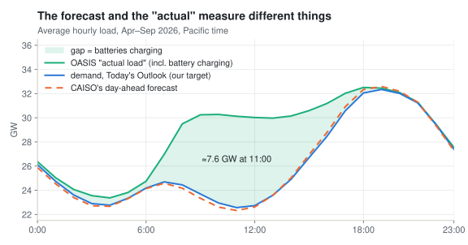
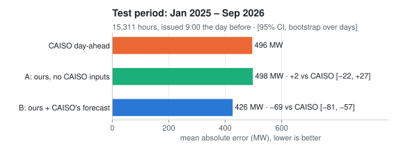
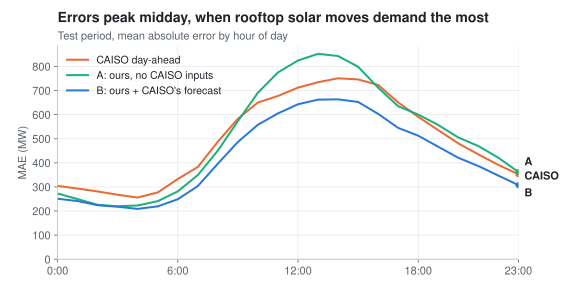

# caiso-forecasting

Forecast California's electricity demand a day ahead and compare it with the grid operator's own forecast. Public data only, Python (LightGBM + PyTorch), backtested on 2025–2026.

## The idea

Every morning CAISO, California's grid operator, publishes a forecast of the next day's hourly demand. It's final around 9:30, and day-ahead market bids close at 10:00. Can a model built from public data match it?

First, a trap. OASIS, CAISO's public data site, publishes an "actual load" that includes grid batteries charging. CAISO's forecast doesn't include them. Batteries now soak up ~7 GW of midday solar, so scored against OASIS, CAISO looks twice as bad as it really is:



So the target here is CAISO's Today's Outlook demand, which is measured the same way as the forecast.

## How it works

- **Same timing as CAISO.** At 9:00 Pacific on day D-1, forecast all 24 hours of day D. Inputs are load through 8:00 and weather forecasts from runs already published by 9:00 (GFS and JMA, from Open-Meteo's archive of past runs). `test_leakage.py` corrupts all data after the cutoff and checks that no feature changes.
- **Three models, averaged.**
  - A small MLP that predicts the whole 24-hour profile at once from recent load curves and tomorrow's hourly weather.
  - LightGBM.
  - LightGBM with one model per hour of day.
- **Honest backtest.** Every month, the models retrain on all earlier data. All choices were made on 2024. The test period (Jan 2025 – Sep 2026) was run once, at the end.

## Results



- **A, our forecast alone, ties CAISO** (498 vs 496 MW mean error).
- **B, our forecast averaged with CAISO's (plus a model that corrects CAISO's), is 14% better** (426 MW). A market participant can do this: CAISO's forecast is public at ~9:30, before bids close at 10:00. B beats CAISO on 70% of days and at each day's peak hour.
- **Weather wasn't the bottleneck.** Given the weather that actually happened, the model improved only from 630 to 621 MW. The gains came from modelling: cloud forecasts, recent-temperature features, the whole-day MLP, and averaging.
- **Midday is the hard part.** Rooftop solar keeps growing: on spring weekdays, noon demand fell from 0.79× to 0.66× of 8pm demand between 2020 and 2026. Errors peak there for everyone:



Didn't help: linear-leaf trees, correcting recent bias, an L1 loss, more MLP tuning.

## Running it

```
cd dayahead
pip install -r requirements.txt
python fetch_oasis.py ACTUAL; python fetch_oasis.py DAM; python fetch_oasis.py 2DA
python fetch_outlook.py
python fetch_weather.py gfs_seamless 2021-03-01 2026-10-16    # also jma_seamless (2020-), obs
python test_leakage.py
python final.py test                                         # trains everything, prints the table
python ../docs/make_figures.py
```

No GPU needed. Each experiment trains in minutes on a laptop.

| File | What it is |
|---|---|
| `dayahead/data.py` | Load, CAISO forecasts, and weather as known at 9:00 |
| `dayahead/features.py` | Load lags, weather, solar and calendar features |
| `dayahead/nn.py` | Whole-day MLP |
| `dayahead/backtest.py` | Monthly-retrain backtest, LightGBM wrappers, metrics |
| `dayahead/exp.py`, `run_one.py` | Named experiments, each in its own process (PyTorch and LightGBM clash in one) |
| `dayahead/final.py` | Frozen final configs and the comparison with CAISO |
| `dayahead/fetch_*.py` | Downloaders for OASIS, Today's Outlook and Open-Meteo |

[`hourahead/`](hourahead) is the class project this grew out of: 1-hour-ahead models (OLS, random forest, XGBoost, BiLSTM, ST-CALNet).
